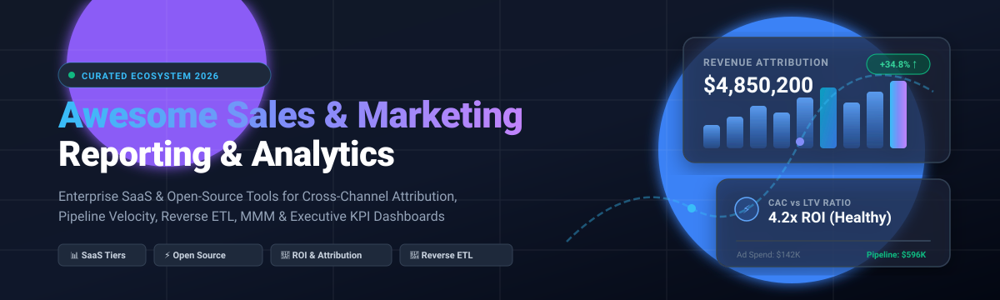

# 📊 Awesome Sales & Marketing Reporting

  <strong>Curated ecosystem of SaaS software, open-source platforms, attribution modeling libraries, and KPI dashboard engines for modern revenue operations (RevOps), marketing analytics, and sales intelligence.</strong>

  
  
  
  
  
  

---

*Focused on Cross-Channel Attribution, Multi-Touch Modeling, Pipeline Velocity, Reverse ETL, and Executive KPI Dashboards*  
📅 **Last updated: November 2026**

This repository tracks notable **SaaS platforms** and **open-source projects** for **Sales & Marketing Reporting**. These tools empower revenue operations (RevOps), digital marketing, and sales leadership teams to unify cross-channel data across CRMs, advertising networks (Google Ads, Meta, LinkedIn), email automation platforms, and web analytics into single-source-of-truth executive dashboards—measuring pipeline velocity, customer lifetime value (LTV), customer acquisition cost (CAC), and return on ad spend (ROAS) without manual spreadsheets.

- **Enterprise SaaS category leaders**: HubSpot Performance Reporting, Tableau, Microsoft Power BI, Databox, Klipfolio, Looker, Domo, Geckoboard, AgencyAnalytics, and Supermetrics.
- **Open-source ecosystem**: Modern open-source data stacks enable complete revenue reporting—combining first-party event tracking (**RudderStack**), warehouse-to-CRM Reverse ETL data activation (**Multiwoven**), advanced Bayesian marketing mix modeling and attribution (**Robyn**, **lightweight_mmm**, **pymc-marketing**, **Marketing-Attribution-Models**), and rapid self-hosted analytics dashboards (**dashbordina**, **superset-supremacy**, **streamlit-sales-dashboard**, **KPI-Insight-Companion**).

> 💡 **Contributions welcome!** Have an open-source reporting library or SaaS platform to suggest? Open a pull request or submit an issue following our [contribution guidelines](#-how-to-contribute).

---

## 📑 Table of Contents

- [🌐 Sector Overview & Market Dynamics](#-sector-overview--market-dynamics)
- [💼 SaaS & Hosted Reporting Platforms](#-saas--hosted-reporting-platforms)
- [⚡ Open-Source GitHub Projects](#-open-source-github-projects)
- [📈 Star History](#-star-history)
- [🤝 How to Contribute](#-how-to-contribute)
- [💖 Support & Sponsorship](#-support--sponsorship)
- [⚠️ Disclaimer](#️-disclaimer)

---

## 🌐 Sector Overview & Market Dynamics

The global sales and marketing reporting and analytics software sector is estimated at approximately **$12B to $19B** (anchored by the ~$5.5B sales analytics market and ~$6.5B marketing analytics market, expanding at 12–16% CAGR toward a combined $30B+ by 2030). 

The sector is **moderately fragmented**: while cloud hyperscalers and CRM giants (Microsoft, Google Cloud, Salesforce/Tableau, HubSpot) anchor enterprise data ecosystems, there is no winner-take-all monopoly because diverse agency use cases, privacy regulations, multi-channel attribution complexities, and connector requirements sustain a thriving landscape of specialized best-of-breed vendors and open-source stacks.

---

## 💼 SaaS & Hosted Reporting Platforms

Below is a curated comparison of leading sales and marketing reporting SaaS platforms, including specific entry tier pricing, exact free tier and trial limits, and company scale sorted in descending order by market valuation/revenue.

| 🏢 Platform | 📈 Company Scale (Valuation / Revenue) | 🏷️ Starting Tier Pricing | 🎁 Free Tier / Trial Limits | 📝 Overview & Core Strengths |
| :--- | :--- | :--- | :--- | :--- |
| **[Power BI](https://powerbi.microsoft.com/)** | **~$3.1T+ Market Cap** (Microsoft parent) | **$14/user/month** (Power BI Pro, billed annually) | **Free tier available**: Power BI Desktop / Fabric free tier for personal authoring; 1 GB model cap, restricted to "My Workspace", no shared cloud dashboard publishing or automated cloud refreshes | 📊 Microsoft's enterprise BI platform; common for sales and marketing reporting in Microsoft-centric organizations, with DAX and Power Query. |
| **[Looker](https://looker.com/)** | **~$2.1T+ Market Cap** (Alphabet parent; acquired for $2.6B) | **~$35,000/year** (Enterprise platform contract quote) | **30-day free trial** available for cloud evaluation; Google Looker Studio offers a free perpetual tier for basic dashboard authoring and sharing | 🔍 Google Cloud enterprise BI platform built on LookML for governed metric definitions; unified sales and marketing data models on BigQuery. |
| **[Tableau](https://www.tableau.com/)** | **~$300B+ Market Cap** (Salesforce parent; acquired for $15.7B) | **$75/user/month** (Tableau Creator, billed annually; Viewer licenses at $15/user/month) | **14-day free trial** of Tableau Cloud & Desktop Creator; Tableau Public offers a free tier for public-only dashboards (15M row limit, 10 GB storage, no private data sharing) | 📈 Enterprise visual analytics platform; widely used for marketing dashboards connected to data warehouses or CRM exports. |
| **[HubSpot Performance Reporting](https://www.hubspot.com/)** | **~$32B+ Market Cap** (Public: NYSE: HUBS, ~$2.5B ARR) | **$15/user/month** (Sales/Marketing Hub Starter, billed annually) | **Free tier available**: Free CRM tools up to 2 users, 1,000 marketing contacts, and 2,000 email sends/month (includes HubSpot branding; custom multi-step reporting requires paid tiers) | 🎯 Native reporting within HubSpot's Marketing and Sales Hubs; dashboards for campaign ROI, deal pipeline, and attribution tied to CRM records. |
| **[Supermetrics](https://supermetrics.com/)** | **~$280M+ Valuation** (~$90M ARR; €40M Series B) | **$44/month** (Starter tier, billed annually) | **14-day free trial** of connectors and destinations; no permanent free tier | 🔌 Data connector platform pulling ad and CRM data (Google Ads, Meta, LinkedIn, HubSpot) into Google Sheets, Excel, Looker Studio, and warehouses. |
| **[Domo](https://www.domo.com/)** | **~$300M+ Market Cap** (Public: NASDAQ: DOMO, ~$320M ARR) | **~$30,000/year** (Credit-based consumption model packages) | **30-day free trial** with full enterprise features; limited freemium tier capped at 300 credits/month for qualifying evaluations | ☁️ Cloud BI platform with broad connector libraries and business-user-friendly dashboards for operational and executive reporting. |
| **[AgencyAnalytics](https://agencyanalytics.com/)** | **~$50M–$100M+ Valuation** (~$20M ARR, bootstrapped) | **$20/client/month** (Billed annually; scalable per-client model) | **14-day free trial** (no credit card required, includes all standard client dashboards); no permanent free plan | 👥 Dedicated reporting platform for marketing agencies; multi-client dashboards, white-labeling, and 80+ integrations for SEO, PPC, and social. |
| **[Klipfolio](https://www.klipfolio.com/)** | **~$30M–$45M Valuation** (~$14M ARR; $17M funded) | **$120/month** (Base tier, billed annually) | **14-day free trial** (full access, no credit card required); no permanent free plan | 📋 Cloud BI and dashboard platform with pre-built metric libraries for marketing teams seeking KPI dashboards without a full data warehouse. |
| **[Databox](https://databox.com/)** | **~$20M–$40M Valuation** (~$10M–$25M ARR; $4.5M funded) | **$71/month** (Analyst tier, billed annually; Team Core at $199/month) | **Free tier available**: 1 user, 3 data source connections, 1 dashboard, 10 custom metrics, 11 months historical data, daily sync | 📱 Dashboard platform with 100+ pre-built integrations for marketing and sales tools; focused on goal tracking, alerts, and agency client reporting. |
| **[Geckoboard](https://www.geckoboard.com/)** | **~$10M–$20M Valuation** (~$4M–$7M ARR; $4M funded) | **$79/month** (Essential tier, billed annually) | **14-day free trial** (full access, no credit card required); no permanent free plan | 📺 Real-time KPI dashboard platform focused on team visibility; popular for live sales floor TV screens and marketing performance snapshots. |

---

## ⚡ Open-Source GitHub Projects

The following curated open-source projects power sales and marketing reporting pipelines, ranging from first-party event tracking and Reverse ETL data activation to Bayesian marketing mix modeling (MMM), multi-touch attribution, and self-hosted dashboards. Repositories are ranked in descending order by GitHub star count.

| 📦 Repository | ⭐ Stars | 🎯 Domain / Focus Area | 🛠️ Description |
| :--- | :--- | :--- | :--- |
| **[rudderlabs/rudder-server](https://github.com/rudderlabs/rudder-server)** |  | 🔄 Customer Data Platform & Tracking | Open-source, enterprise-ready Customer Data Platform (CDP) and event-stream engine (alternative to Segment). Tracks, collects, and unifies first-party customer touchpoints across web, mobile, and server-side apps, routing event data into analytics warehouses for attribution and sales reporting. |
| **[Multiwoven/multiwoven](https://github.com/Multiwoven/multiwoven)** |  | 🚀 Reverse ETL & Data Activation | Open-source Reverse ETL platform (AGPLv3) syncing aggregated reporting data from warehouses (Snowflake, BigQuery, Redshift, PostgreSQL) into CRM and ad platforms (Salesforce, HubSpot, Meta Ads, Google Ads). Acts as the activation engine feeding metrics back to revenue teams. |
| **[facebookexperimental/Robyn](https://github.com/facebookexperimental/Robyn)** |  | 📉 Marketing Mix Modeling (MMM) | Meta's open-source experimental Marketing Mix Modeling (MMM) package in R and Python. Uses machine learning (evolutionary algorithms via Nevergrad) to assess multi-channel advertising effectiveness, adstock decay, and budget allocation across digital and offline campaigns. |
| **[pymc-labs/pymc-marketing](https://github.com/pymc-labs/pymc-marketing)** |  | 🧮 Bayesian Marketing Analytics | Python library for Bayesian marketing analytics built on PyMC. Provides battle-tested models for Marketing Mix Modeling (MMM), customer lifetime value (CLV / BG/NBD, Gamma-Gamma), and budget optimization to evaluate campaign yield and revenue attribution under uncertainty. |
| **[google/lightweight_mmm](https://github.com/google/lightweight_mmm)** |  | 🔬 Bayesian Media Mix Modeling | Google's lightweight Bayesian Marketing Mix Modeling package built on JAX and NumPyro. Helps marketing data scientists measure marketing channel efficiency, compute ROI curves, and optimize future marketing budget distributions. |
| **[snowplow-referer-parser/referer-parser](https://github.com/snowplow-referer-parser/referer-parser)** |  | 🌐 Attribution & Referrer Parsing | Snowplow's open-source multi-language library for parsing HTTP referrer URLs to identify search engines, social platforms, email clients, and ad networks for precise marketing attribution analysis. |
| **[DP6/Marketing-Attribution-Models](https://github.com/DP6/Marketing-Attribution-Models)** |  | 📐 Multi-Touch Attribution Modeling | Python library implementing standard and data-driven marketing attribution algorithms—including first-touch, last-touch, linear, time-decay, position-based, Markov chains, and Shapley values—for cross-channel sales conversion paths. |
| **[Sven-Bo/streamlit-sales-dashboard](https://github.com/Sven-Bo/streamlit-sales-dashboard)** |  | 📊 Streamlit Sales Dashboard | Interactive Python and Streamlit sales analytics dashboard visualizing transaction and pipeline metrics from spreadsheets or databases, featuring dynamic KPI cards, revenue breakdowns, and filterable charts. |
| **[GoogleCloudPlatform/marketing-analytics-jumpstart](https://github.com/GoogleCloudPlatform/marketing-analytics-jumpstart)** |  | ☁️ Marketing Analytics Jumpstart | Google Cloud reference architecture and pipeline solution that ingests, harmonizes, and models cross-channel marketing data in BigQuery for Looker dashboards and smart bidding activation. |
| **[MerlinStacks/overseek](https://github.com/MerlinStacks/overseek)** |  | 🛒 E-commerce Operations Dashboard | Open-source e-commerce analytics dashboard for WooCommerce merchants (Docker Compose, PostgreSQL) tracking revenue, conversion attribution, customer cohort retention, and live acquisition channels. |
| **[eduardocornelsen/full-funnel-ai-analytics](https://github.com/eduardocornelsen/full-funnel-ai-analytics)** |  | 🤖 Full-Funnel AI Analytics Stack | Modern marketing analytics data stack powered by dbt MetricFlow, Python, and Model Context Protocol (MCP), delivering natural language queries and lead scoring across Google Ads, Meta Ads, and CRMs. |
| **[avrtt/dashbordina](https://github.com/avrtt/dashbordina)** |  | 🧪 Marketing Analytics Stack Prototype | Marketing analytics stack featuring PostgreSQL, Apache Airflow ETL DAGs, FastAPI metrics endpoint, and Plotly Dash interface calculating CAC, CLV, and multi-channel ROAS. |
| **[avrtt/superset-supremacy](https://github.com/avrtt/superset-supremacy)** |  | 📈 Apache Superset Marketing Dashboard | Docker-ready Apache Superset prototype configured with marketing KPI charts, budget vs. actual spend tracking, funnel conversion analysis, and ROI forecasting models. |
| **[femi-oloye/KPI-Insight-Companion-for-SaaS](https://github.com/femi-oloye/KPI-Insight-Companion-for-SaaS)** |  | 💡 AI SaaS KPI Companion | AI-augmented SaaS metric visualizer built in Streamlit and Plotly with GPT natural language querying for CAC, LTV, MRR, churn rate, and anomaly alerts. |
| **[badrr06/SalesIq](https://github.com/badrr06/SalesIq)** |  | 📉 Sales Tracking & Forecasting | Lightweight sales management and time-series forecasting web app (Flask, Chart.js, SQLAlchemy) generating monthly revenue trends and ARIMA-based 6-month sales forecasts. |

---

## 📈 Star History

---

## 🤝 How to Contribute

Contributions are welcome and appreciated! To add a new platform or maintain this list:

1. 🍴 **Fork** the repository.
2. 🌿 Create a new branch (`git checkout -b feature/add-new-reporting-tool`).
3. 📝 Update `README.md` following the established table structure (accurate pricing, free tier parameters, company scale, or star badges linked to stargazers).
4. ✅ Ensure descriptions are factual, objective, and verified against official sources.
5. 🚀 Open a **Pull Request** with a concise summary of the addition or revision.

---

## 💖 Support & Sponsorship

If you find this curated ecosystem helpful for your sales operations, marketing stack research, or open-source analytics journey, please consider showing your support:

- ⭐ **Star this repository** to help others discover it on GitHub!
- 🍴 **Fork and share** it with your fellow revenue operations (RevOps), growth, and analytics peers.
- ☕ **Buy a coffee & sponsor**: If this project saves you time evaluating reporting tools, consider supporting ongoing curation via the [GitHub Sponsors Dashboard](https://github.com/sponsors/ishandutta2007). Your support keeps this ecosystem maintained, accurate, and up-to-date!

---

## ⚠️ Disclaimer

- This is a **community-curated** list — not exhaustive and not an endorsement of any particular vendor.
- Sales and marketing reporting platforms handling customer and revenue data must comply with applicable privacy regulations (GDPR, CCPA) and data security policies; **self-hosted solutions place full responsibility for data pipeline reliability, metric accuracy, and access controls on the operator**.
- **Open-source sales and marketing reporting is fragmented across components**: RudderStack captures customer touchpoints, Multiwoven syncs metrics to CRMs, libraries like Robyn and pymc-marketing run attribution and MMM, and Superset/Streamlit power dashboards. However, **no single open-source project matches Databox or AgencyAnalytics for turnkey multi-client reporting with pre-built connector libraries**—organizations requiring that depth should evaluate commercial platforms or invest in custom integration.
- Verify license terms for commercial use (AGPLv3, MIT, Apache 2.0).

---

  Made with ❤️ for marketing operations leaders, sales analysts, and revenue teams building reporting infrastructure.

